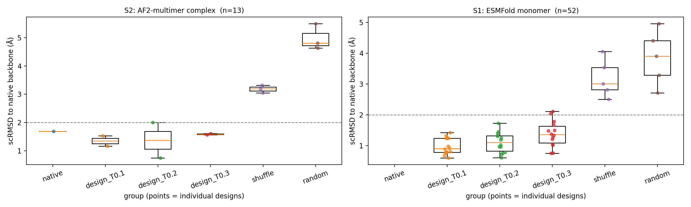
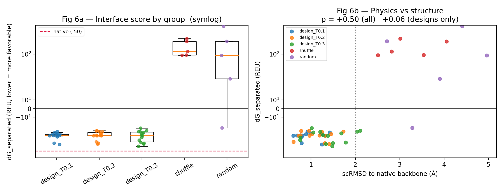

# VHH inverse-folding self-consistency benchmark

[한국어](README.md) | **English**

> This is a condensed summary. The Korean [`README.md`](README.md) is the
> source document and carries the full method, every limitation, and the
> reasoning behind each decision. Code, CSVs and figures are language-neutral
> and are shared by both.

Does a nanobody sequence redesigned by ProteinMPNN fold back to the backbone
it came from? That is the self-consistency question, and it is easy to answer
badly: a redesigned sequence will usually look plausible, and a structure
predictor will usually return something. The work here is mostly about the
controls that make the answer mean anything.

Target is PDB **8YVJ** — the H5.2 nanobody (VHH, 129 aa) bound to a
*C. difficile* toxin A CROPs fragment (118 aa), X-ray at 1.65 Å.

---

## The three findings

**1. What works.** Redesigned sequences do reproduce the original backbone,
and the negative controls do not come close.

| group | scRMSD (median, ESMFold) |
|---|---|
| ProteinMPNN designs | **1.20 Å** |
| composition-preserving shuffle | 3.01 Å |
| random substitution | 3.90 Å |

The shuffle control keeps the amino acid composition and destroys only the
order. Designs separating from it means the 1.2 Å comes from choosing which
residue goes where, not from the sequence merely looking like a protein.

**2. What does not work.** The complex interface could not be evaluated at
all. The positive control failed first: native 8YVJ scored ipTM 0.12 against
a 0.5 threshold, so AF2-multimer was not reproducing a complex that is known
from a 1.65 Å crystal structure. That axis is therefore reported as a
measurement failure, not as a result about the designs.

**3. What was done about it.** A physics-based route (PyRosetta
InterfaceAnalyzer) recovered part of the interface axis. The criteria for
that route were registered before it was run, and the commit order shows it.

| metric | native | designs | shuffle | random | separates designs from controls? |
|---|---|---|---|---|---|
| `dG_separated` (REU) | −49.6 | −30.7 | +105.2 | +37.5 | yes, completely |
| interface hydrogen bonds | 13 | 8 | 5 | 6 | yes, monotonic |
| **buried unsatisfied polar atoms** | **5.0** | **12.5–14.5** | 13.0 | 15.5 | **no, overlapping** |

The last row is the one axis where designs are indistinguishable from the
random control. A polar atom buried at an interface has to find a hydrogen
bond partner on the other side; when it cannot, it costs binding. ProteinMPNN
recovers the shape and the energy but not this.

---

## Figures



Designs against the two control groups, split by predictor. Each `.pml` and
plotting script is committed, so the selections behind every figure can be
read rather than trusted.



The Rosetta cross-check. Designs score 42/42 with `dG_separated` < 0;
shuffle scores 0/5. Native ranks first overall at −49.6 REU.

---

## Pre-registered criteria and what passed

| applied to | passed |
|---|---|
| S1, ESMFold (scRMSD + pLDDT) | 40 / 52 |
| S2, AF2-multimer (scRMSD + pLDDT) | 4 / 13 |
| S2 with ipTM included | 1 of 6 designs |
| S2 native, the positive control | **failed** (pLDDT 78.9, ipTM 0.12) |
| exploratory: designs better than shuffle | passed (−31.2 vs +116.3) |
| exploratory: native in the top half | passed (−49.6, ranked first) |

The positive control failing is the reason the ipTM column is reported as a
measurement failure. Had the criteria been written after seeing the numbers,
that row would be easy to drop.

---

## Method

| stage | tool | note |
|---|---|---|
| target selection | RCSB Search API | the only one of three candidates whose antigen is not a peptide |
| preprocessing, region definition | PDBFixer, OpenMM, Biopython | 34 of 129 positions redesigned = interface (4.5 Å) ∪ CDR3 |
| sequence design | ProteinMPNN | 48 designs (2 modes × 3 temperatures × 8) plus 17 controls |
| monomer re-prediction | ESMFold | single-sequence, so no MSA is available to leak information |
| complex re-prediction | ColabFold, AF2-multimer v3 | reduced settings: 1 model, 3 recycles, 1 seed |
| interface cross-check | PyRosetta ref2015, InterfaceAnalyzer | exploratory, registered in advance |
| figures | PyMOL, headless | `.pml` generated from data and committed |

ESMFold is used for the first pass for a methodological reason rather than a
cost one: designed sequences have no natural homologues, so an MSA-dependent
predictor has nothing to work with.

---

## What this work does not claim

1. **No experimental validation.** In silico self-consistency is not a proxy
   for expression or binding.
2. **The interface was not evaluated by prediction.** The positive control
   failed, so nothing is claimed on that axis.
3. **n is small.** 14 per condition for S1, 1–3 for S2. No statistical tests
   were run; group medians and ratios only.
4. **Reduced AF2 settings** understate prediction uncertainty.
5. **Selection bias in S2.** The 13 structures were chosen by top ESMFold
   pLDDT, so they are the better designs rather than a representative sample.
6. **One target.** No generalisation is claimed.
7. **The redesign region is not the textbook CDR definition.** ANARCI was not
   used; the region is interface ∪ CDR3 by coordinates.
8. **Higher pLDDT for designs than for native does not mean better.** pLDDT
   measures the predictor's confidence, and one random control scored 85.4
   while landing 5.50 Å away.

The Korean README lists twelve limitations with the reasoning behind each.

---

## Reproducing

The notebook with outputs is committed as the primary record. The Rosetta and
figure stages run from the committed intermediates:

```bash
git clone https://github.com/OHfromH2O/vhh-mpnn-selfconsistency
cd vhh-mpnn-selfconsistency
python scripts/06_render.py          # figures, PyMOL
```

PyRosetta and PyMOL do not run on native Windows. Use WSL2 or Linux. See the
Korean README for the full reproduction path and the version-pinned method
table.

---

## Licence notice

ProteinMPNN is used under the MIT License (Copyright (c) 2022 Justas
Dauparas). Structure 8YVJ is from the RCSB PDB.

**PyRosetta needs its own licence.** It is free for academics but you have to
obtain it yourself; mine does not transfer to readers. The results of that
stage are committed as CSVs, so the numbers can be checked without it.
