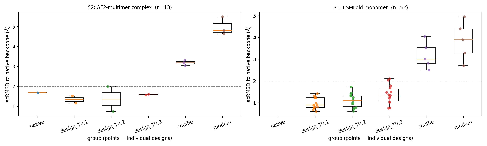
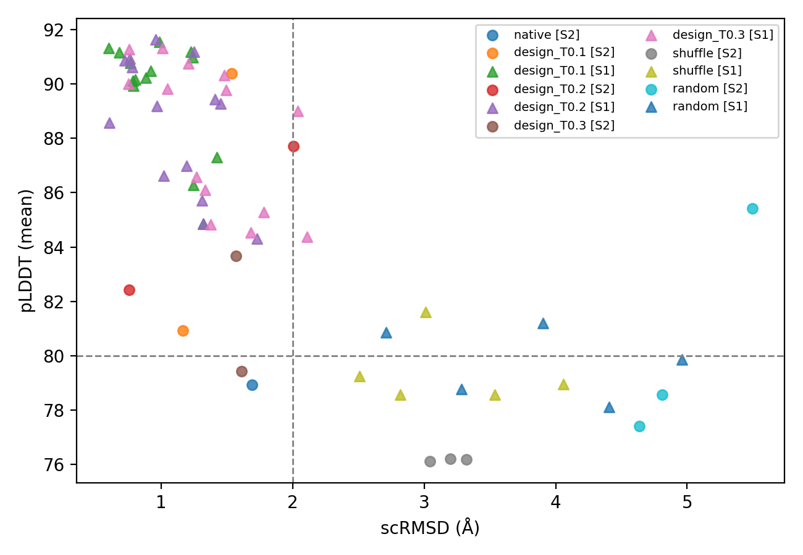

# VHH inverse-folding self-consistency benchmark

ProteinMPNN으로 재설계한 나노바디 서열이, 독립적인 구조 예측기로 되돌렸을 때
원본 backbone을 재현하는가(self-consistency)를 음성·양성 대조군과 함께 측정한 벤치마크 실습.

타깃: **PDB 8YVJ** — H5.2 나노바디(VHH, 129 aa) / *C. difficile* toxin A CROPs 단편(118 aa), X-ray 1.65 Å

---

## 무엇을 했는가

1. RCSB Search API로 나노바디 복합체 후보를 조회하고, **사슬 구성으로 2차 선별**해 타깃을 확정했습니다.
   해상도 ≤ 2.5 Å · 총 ≤ 300잔기 조건을 만족한 3건 중, 항원이 펩타이드가 아닌 단백질인 것은 8YVJ뿐이었습니다
   (나머지 2건은 14 aa Tau PHF6 펩타이드 복합체). → `data/chain_composition.csv`
2. PDBFixer로 전처리하고, 재설계 영역을 **항원과 4.5 Å 이내 접촉하는 잔기 ∪ CDR3** (34/129자리)로 정의했습니다.
   → `work/01_clean/designable.json`, 정의 변경 사유는 [`work/01_clean/README_definition_note.md`](work/01_clean/README_definition_note.md)
3. ProteinMPNN으로 **2모드 × 3온도 × 8서열 = 48 설계 서열**을 생성했습니다.
   - M1: VHH 전체 129자리 재설계 / M2: 위 34자리만 재설계(프레임워크 고정)
   - temperature 0.1 / 0.2 / 0.3
4. **대조군 17건**: 조성 보존 셔플 8, 완전 무작위 치환 8 (모두 재설계 영역 한정), native 1(양성 대조군)
5. 2단계로 재예측했습니다.
   - **S1**: ESMFold로 VHH 단량체 65건 전부
   - **S2**: ColabFold(AF2-multimer v3)로 복합체 13건 (S1 pLDDT 상위 설계 6 + 대조군 6 + native 1)
6. scRMSD · TM-score · pLDDT(전체/재설계 영역) · ipTM · seq_recovery를 산출했습니다.

---

## 무엇을 하지 않았는가

다음은 본 산출물로 **입증되지 않습니다.**

- 설계 서열이 실제로 발현·폴딩된다는 것 (실험 검증 없음)
- 설계 서열이 항원에 결합한다는 것 (결합 친화도 미측정)
- **복합체 계면을 재현한다는 것** — ipTM 측정에 실패했습니다 (아래 결과 참조)
- 통계적 유의성 (N이 작아 기술통계 수준의 비교만 수행)

**확실히 주장할 수 있는 사실:** 주어진 backbone에 대해 inverse folding으로 생성한 서열이,
독립적인 구조예측기로 되돌렸을 때 원본 backbone을 재현하며, 그 재현도가 음성 대조군보다
명확히 높다.

---

## 사전 등록된 기준

판정 기준은 [`protein_design_sc_protocol.md`](protein_design_sc_protocol.md)(2026-10-22) §0.3에 코드 실행 전부터 적혀 있었고,
결과를 본 뒤 완화하거나 변경하지 않았습니다. 다만 이를 담은 [`preregistration.md`](preregistration.md) 파일은
**분석을 마친 뒤에 작성**되었으므로, 선후를 증명할 커밋 기록은 없습니다.
그 사실과 "데이터를 본 뒤에 내린 결정" 목록을 [`preregistration.md`](preregistration.md)에 전부 적었습니다.

```
성공 판정 (설계 1건 단위)
  scRMSD (재예측 구조 vs 원본 backbone, Cα) < 2.0 Å
  재예측 pLDDT 평균 > 80
  (복합체 수행 시) ipTM > 0.5

H1: 설계 서열의 scRMSD 중앙값 < 셔플 대조군의 scRMSD 중앙값
H0: 차이 없음
```

**기준은 사후에 변경하지 않았습니다.** 아래 통과 집계는 위 기준을 그대로 적용한 결과입니다.

---

## 방법 (버전 고정)

| 항목 | 값 |
|---|---|
| 실행 환경 | Google Colab, Tesla T4 (15,360 MiB), Linux 6.6.122, Python 3.13.16 |
| 실행 시각 | 2026-10-26 05:52 UTC |
| seed | 42 (전 단계 고정) |
| ProteinMPNN | `dauparas/ProteinMPNN` (MIT License), `vanilla_model_weights/v_48_020.pt` |
| ESMFold | `facebook/esmfold_v1` (HuggingFace transformers), 언어모델 fp16 / 폴딩 트렁크 fp32 |
| ColabFold | `alphafold2_multimer_v3`, `--num-recycle 3 --num-models 1 --random-seed 42` |
| 전처리 | PDBFixer 1.x + OpenMM 8.6.1 (측쇄 보완, 말단 결측은 보완하지 않음) |
| 구조 비교 | Biopython 1.88 Cα 중첩 (US-align 미사용 — 아래 한계 참조) |
| 기타 | numpy 2.1.3, pandas 2.2.3, matplotlib 3.10.0, torch 2.11.0+cu130 |

전 단계의 seed·버전·플랫폼은 `work/04_metrics/provenance.json`과 각 출력 CSV의 컬럼에 기록됩니다.

---

## 결과

### 표 1a — 예측기 × 그룹 요약 (scRMSD 중앙값, Å)

|  | n | scRMSD | TM-score | pLDDT(전체) | **pLDDT(재설계 영역)** | ipTM | seq_recovery |
|---|---:|---:|---:|---:|---:|---:|---:|
| S1 design_T0.1 | 14 | **0.90** | 0.97 | 90.4 | **85.0** | — | 0.52 |
| S1 design_T0.2 | 14 | **1.10** | 0.96 | 89.2 | **83.1** | — | 0.50 |
| S1 design_T0.3 | 14 | **1.36** | 0.94 | 89.4 | **82.1** | — | 0.50 |
| S1 shuffle | 5 | 3.01 | 0.83 | 78.9 | 56.3 | — | 0.06 |
| S1 random | 5 | 3.90 | 0.77 | 79.9 | 58.4 | — | 0.00 |
| S2 native | 1 | 1.69 | 0.92 | 78.9 | 60.7 | **0.12** | 1.00 |
| S2 design_T0.1 | 2 | 1.35 | 0.93 | 85.7 | 72.5 | 0.48 | 0.52 |
| S2 design_T0.2 | 2 | 1.38 | 0.93 | 85.1 | 73.3 | 0.40 | 0.52 |
| S2 design_T0.3 | 2 | 1.59 | 0.94 | 81.6 | 67.5 | 0.18 | 0.54 |
| S2 shuffle | 3 | 3.20 | 0.80 | 76.2 | 51.3 | 0.14 | 0.12 |
| S2 random | 3 | 4.81 | 0.70 | 78.6 | 53.5 | 0.14 | 0.03 |

S1 = ESMFold 단량체, S2 = AF2-multimer 복합체. **두 예측기는 입력도 모델도 다르므로 한 축에서 비교하지 않습니다.**
S2 13건의 개별 값은 [`work/04_metrics/table1.md`](work/04_metrics/table1.md) 표 1b 참조.

### Fig 1 — 그룹별 scRMSD 분포



예측기별 2패널(왼쪽 S2 AF2-multimer 복합체, 오른쪽 S1 ESMFold 단량체).
점선은 사전 등록 임계값 2.0 Å. N이 작으므로 개별 점을 모두 표시했습니다.

### Fig 2 — scRMSD vs pLDDT



색 = 그룹, 모양 = 예측기(`o` S2 / `^` S1).
오른쪽 위에 외따로 찍힌 `random [S2]` 점이 random_s3입니다 —
pLDDT 85.4로 높은데 scRMSD는 5.50 Å으로 최악입니다. **신뢰도 지표가
정확도의 대리 지표가 아니라는 것**을 한 점으로 보여줍니다.

### (1) H1 지지 — 두 예측기 모두

| stage | design | shuffle | random |
|---|---|---|---|
| S1 (n=52) | **1.20 Å** | 3.01 Å | 3.90 Å |
| S2 (n=13) | **1.55 Å** | 3.20 Å | 4.81 Å |

조성을 보존한 셔플 대조군이 3 Å 이상이라는 점이 핵심입니다. 설계의 1.2 Å은
"그럴듯한 아미노산 조성"이 아니라 **위치별 선택**에서 나옵니다.

### (2) 샘플링 온도의 효과는 scRMSD에서만 보인다

| temperature | scRMSD (S1) | seq_recovery | pLDDT |
|---|---|---|---|
| 0.1 | **0.90** | 0.52 | 90.4 |
| 0.2 | **1.10** | 0.50 | 89.2 |
| 0.3 | **1.36** | 0.50 | 89.4 |

recovery와 pLDDT는 평평한데 scRMSD만 단조 증가합니다. 다양성–정확도 트레이드오프가
실재하되 **서열 복원율로는 보이지 않는다**는 것으로, seq_recovery를 품질 지표로 쓰면 안 되는
이유를 본 데이터가 직접 보여줍니다.

### (3) pLDDT는 재설계 영역에서 재야 판별력이 있다

전체 평균으로는 설계 90 vs 대조군 79로 **10점** 차이지만, 재설계 34자리만 보면
85 vs 56으로 **26점** 차이입니다. 무작위 서열의 전체 pLDDT가 79점이나 되는 이유는
129잔기 중 95잔기(프레임워크)를 건드리지 않아 평균이 희석되기 때문입니다.

### (4) M1(전체 재설계)과 M2(CDR 한정)는 차이가 없다

| mode | n | scRMSD | pLDDT(재설계 영역) | seq_recovery |
|---|---:|---:|---:|---:|
| M1 (129자리) | 19 | 1.19 | 83.8 | 0.50 |
| M2 (34자리) | 23 | 1.21 | 84.9 | 0.53 |

M2는 프레임워크 95자리를 원본 그대로 물려받는데도 사슬 전체 scRMSD가 M1과 같습니다.
M1이 새로 쓴 95자리에서 오차가 유의하게 발생했다면 M1이 나빠야 하므로, 이 결과는
**프레임워크 재현은 쉽고 잔여 오차가 재설계 루프에 집중**됨을 시사합니다.

### (5) 이황화결합 보존 — 설계 100%, 셔플 12.5%, 무작위 0%

재설계 영역에 포함된 Cys110(나노바디 CDR1–CDR3 추가 이황화결합의 파트너)을
설계 48건이 **전부** 보존했습니다. → `work/04_metrics/cys_retention.csv`

### (6) ipTM 측정 실패 — 음성 결과

**양성 대조군인 native 서열의 ipTM이 0.12**입니다. 실제로 결정화된 복합체인데
사전 등록 임계값 0.5의 1/4 수준입니다.

양성 대조군이 통과하지 못하는 지표로는 설계를 평가할 수 없습니다. 설계 2건이 0.82·0.67로
native보다 높게 나왔지만, 같은 실행에서 **무작위 치환 대조군 random_s3가 0.59**를
기록했습니다(scRMSD 5.50 Å, 최악의 구조). 이 분포는 신호가 아니라 잡음입니다.

따라서 **본 산출물은 ipTM을 결과로 보고하지 않고 측정 실패로 보고하며, 계면 재현에
대해서는 아무것도 주장하지 않습니다.**

### 사전 등록 기준 통과 집계

| 적용 | 통과 |
|---|---|
| S1 (scRMSD + pLDDT) | 40 / 52 |
| S2 (scRMSD + pLDDT) | 4 / 13 |
| **S2 (scRMSD + pLDDT + ipTM 전부)** | **설계 6건 중 1건** (M1_T0.1_s2) |
| S2 native (양성 대조군) | **불통과** (pLDDT 78.9, ipTM 0.12) |

---

## 한계

1. **실험 검증 없음.** in silico self-consistency는 발현성·결합력의 대리 지표가 아닙니다.
2. **ipTM 측정 실패.** 양성 대조군이 임계값에 미달하여 계면 재현을 평가할 수 없었습니다.
   원인은 확인하지 않았습니다 — 축소 설정(모델 1개·recycle 3·단일 seed), 항체–항원 계면에서의
   AF2-multimer 한계, 항원의 β-solenoid 반복 구조가 후보입니다.
3. **n이 작습니다.** S1은 조건당 14건, S2는 조건당 1–3건. 통계적 검정은 수행하지 않았습니다.
4. **AF2 모델 1개 · recycle 3회 · 단일 seed**로 축소 실행 — 예측 불확실성을 과소평가합니다.
5. **S2 선정 편향.** 13건은 ESMFold pLDDT 상위로 골랐으므로 설계 분포의 대표 표본이 아니라
   "최선의 설계들"입니다. 또한 M1 5건 / M2 1건으로 치우쳐 복합체 수준의 모드 비교는 불가능합니다.
6. **단일 타깃.** 일반화를 주장할 수 없습니다.
7. **재설계 영역 정의를 원문 프로토콜에서 변경했습니다.** ANARCI 대신 "인터페이스(4.5 Å) ∪ CDR3"를
   사용했으며, IMGT CDR1/CDR2 전체를 포함하지 않습니다. 사유와 영향은
   [`work/01_clean/README_definition_note.md`](work/01_clean/README_definition_note.md)에 기록했습니다.
8. **US-align 미사용.** Biopython Cα 중첩으로 대체했습니다. inverse folding은 길이를 보존하므로
   Cα 대응은 1:1로 정확하지만, TM-score는 최적 중첩이 아닌 RMSD-최적 중첩에서 계산한
   **근사값**(`tm_score_approx`)입니다.
9. **재현성의 범위.** seed 42로 고정했으나 PyTorch 난수 스트림은 CUDA와 CPU가 다릅니다.
   본 결과는 Colab T4(GPU) 실행본이며, 재현성은 "동일 장치·동일 seed"로 한정됩니다.
10. **ProteinMPNN 설계는 ESMFold가 더 높은 pLDDT를 주었습니다** (설계 89–90 vs native 79, S1 기준).
    이를 "설계가 원본보다 낫다"로 읽어서는 안 됩니다. pLDDT는 정확도가 아니라 예측기의
    자신감이며, random_s3(pLDDT 85.4, scRMSD 5.50 Å)가 그 반례입니다.

---

## 재현 방법

```bash
git clone <this-repo> && cd vhh-mpnn-selfconsistency
# Colab에서 protein_design_sc.ipynb 를 열고 런타임을 T4 GPU로 설정
# 셀 01 → 50 을 순서대로 실행 (10·11은 타깃 선정 기록용, 생략 가능)
```

노트북은 **자신이 있는 폴더를 저장소 루트로 인식**하므로(`LOCAL_ROOT = cwd`),
clone 위치에 관계없이 그대로 동작합니다. 실행 결과를 담은 노트북은
[`protein_design_sc_executed.ipynb`](protein_design_sc_executed.ipynb)에 출력과 함께 보존돼 있습니다.

노트북은 Colab과 로컬 Windows 양쪽에서 동작합니다. 로컬 환경 구축과 단계별 실행 환경은
[`COLAB_RUNBOOK.md`](COLAB_RUNBOOK.md) 참조. GPU 없이 로컬에서 돌릴 경우 ProteinMPNN(CPU, 8서열/27초)까지만
가능하며, 재예측 단계는 GPU가 필요합니다.

---

## 산출물

```
protein_design_sc.ipynb         실행용 노트북 (Colab / 로컬 공용)
protein_design_sc_executed.ipynb  출력이 포함된 실행본 — 본 결과의 원본 기록
protein_design_sc_protocol.md   사전 작성한 기획·프로토콜 문서 (2026-10-22)
data/
  target_candidates.csv       RCSB 조회 결과
  chain_composition.csv       사슬 구성 2차 선별 — 타깃 선정 근거
work/01_clean/
  8YVJ_clean.pdb              전처리 구조
  designable.json             재설계 영역 정의 + 변경 사유
  README_definition_note.md   정의 변경 상세
work/02_mpnn/
  all_sequences.csv           65 서열 (설계 48 + 대조군 16 + native 1)
  all_monomer.fasta / all_complex.fasta / selected.fasta
work/03_refold/
  S1_esmfold/                 ESMFold 구조 65건
  S2_colabfold/               AF2-multimer 구조 13건 + MSA/PAE/점수
work/04_metrics/
  screening.csv               S1 pLDDT
  metrics.csv                 전 지표 + provenance
  cys_retention.csv           이황화결합 보존율
  table1.md                   표 1a / 1b
  provenance.json             seed·버전·플랫폼
figures/
  fig1_scrmsd.png  fig2_scrmsd_vs_plddt.png
```

상세 분석과 해석은 [`RESULTS_ANALYSIS.md`](RESULTS_ANALYSIS.md) 참조.

---

## 라이선스 고지

ProteinMPNN은 MIT License (Copyright (c) 2022 Justas Dauparas) 하에 사용했습니다.
